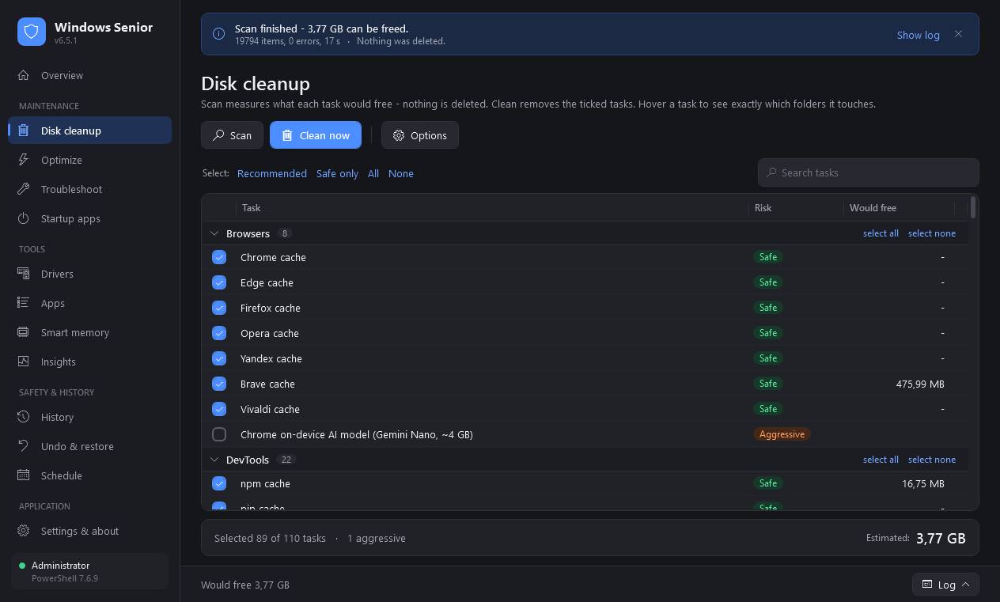
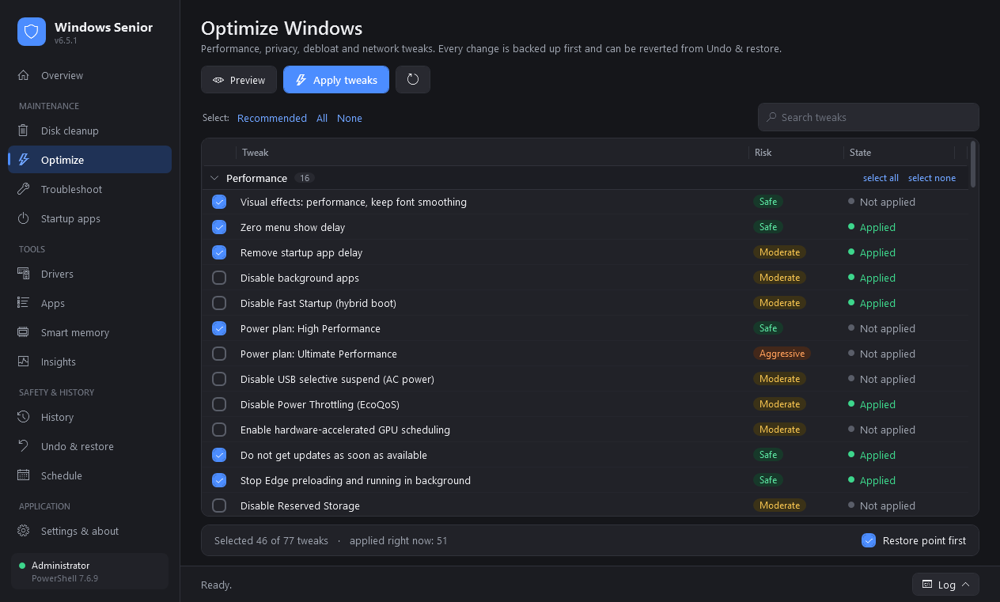

# Windows Senior

[](https://github.com/denfry/WindowsCleaner/actions/workflows/ci.yml)
[](https://github.com/denfry/WindowsCleaner/releases/latest)
[](LICENSE)
[](https://learn.microsoft.com/powershell/)
[](https://discord.gg/mVZcNUAGZt)

Disk cleanup, privacy and performance tweaks, health checks and repairs for Windows 10 and 11.
Written in PowerShell, with a desktop app on top. Free and MIT-licensed.



| | |
|---|---|
| **Disk cleanup** | 110 tasks: browsers, developer tools, messengers, games, system caches, Windows Update, every local disk |
| **Optimize** | 77 tweaks for performance, privacy, debloat and network. Each one is backed up and can be undone |
| **Troubleshoot** | 43 read-only checks; you pick which problems to repair |
| **Startup apps** | Turns entries on and off the way Task Manager does |
| **Drivers** | Updates from Microsoft Update; the GPU vendor's own driver for NVIDIA, AMD and Intel graphics |
| **Apps** | Inventory, silent uninstall with leftover cleanup, updates and installs through winget |
| **Smart memory** | Stops idle build daemons, orphaned JVMs and the WSL VM that hold RAM |
| **Insights** | Boot time before and after a change, a disk-full forecast, "free N GB" planning |

The app and the console menu run the same engine scripts. Anything you do in the window
you can also script, schedule or deploy.

## Install

Open PowerShell and paste:

```powershell
irm https://github.com/denfry/WindowsCleaner/releases/latest/download/install.ps1 | iex
```

The installer needs no admin rights. It:

1. reads `SHA256SUMS.txt` from the latest release and stops if the zip's hash differs;
2. unpacks the app to `%LOCALAPPDATA%\WinSenior\app` and adds a **Windows Senior** shortcut
   to the Start menu and the desktop;
3. starts the app, which asks for Administrator once.

Paste the same line again to update. For options, load the script first:

```powershell
$i = [scriptblock]::Create((irm https://github.com/denfry/WindowsCleaner/releases/latest/download/install.ps1))
& $i -NoLaunch      # install or update, don't start
& $i -Console       # start the console menu instead of the window
& $i -NoShortcut    # no Start menu or desktop shortcut
& $i -Uninstall     # remove the app, shortcuts, scheduled tasks and %ProgramFiles%\WinSenior
```

`install.ps1` is under 300 lines; you can read it on the
[release page](https://github.com/denfry/WindowsCleaner/releases/latest) before running it.

**From a clone:**

```powershell
git clone https://github.com/denfry/WindowsCleaner
cd WindowsCleaner
.\WinSenior.cmd            # the window
.\WinSenior.cmd console    # the arrow-key console menu
```

Requirements: Windows 10 or 11, Windows PowerShell 5.1 or PowerShell 7. The window uses WPF,
which ships with Windows.

## The desktop app



The window follows the Windows display language (English or Russian; you can switch it
under *Settings*).

- **Overview** shows disks, the last cleanup and recent runs. *Smart scan* measures the
  junk and runs the health checks in one pass.
- **Disk cleanup** groups tasks by category with a risk badge on each. *Scan* is a real
  dry run and fills in *Would free*. Hover a task to see the folders it touches. The app
  never pre-ticks a Dangerous task.
- **Optimize** reads the current state of every tweak in the background. Applying one
  creates a restore point and a backup first.
- **Troubleshoot** scans without changing anything, then repairs only what you tick.
- **History**, **Undo & restore** and **Schedule** cover past runs, backups and the
  recurring tasks.

Ctrl+1…9 switch pages, Ctrl+F searches, F5 scans, Ctrl+L opens the log. The app keeps
your selections in `%ProgramData%\WinSenior\gui-settings.json`.

## Safety

- **Dry run.** `-WhatIf` goes through PowerShell's `ShouldProcess`, the same path as a real
  run, so the preview and the cleanup can't drift apart.
- **Restore point.** Each engine creates a System Restore point before changing anything.
  It uses the `SystemRestore` WMI class, so it works in PowerShell 7 too.
- **Protected paths.** The engine refuses drive roots, Windows, Program Files, ProgramData,
  every user profile and its known folders (Documents, Desktop, Downloads and the rest),
  and any folder that contains one of them.
- **Links.** A junction or symlink inside a cleaned folder is removed as a link. The engine
  never follows it to the target.
- **Risk tiers.** Safe, Moderate and Aggressive tasks run by default. Irreversible ones
  (event logs, `Windows.old`, the patch cache, old drivers) need `-IncludeDangerous`.
- **Undo.** Every tweak is written to a backup manifest before it is applied;
  `Optimize-Windows-Senior.ps1 -Undo` reverts a whole run.
- **App leftovers** go to a quarantine for 30 days. Folders that still hold programs or
  another installed app stay where they are.

Start with `-WhatIf` on a machine you care about.

## Command line

Run the scripts from an elevated PowerShell. Each one supports `-WhatIf` and
`-ReportPath <file.json>`.

### Cleanup

```powershell
.\Cleanup-Windows-Senior.ps1 -WhatIf                         # preview, change nothing
.\Cleanup-Windows-Senior.ps1                                 # default run, all users, restore point first
.\Cleanup-Windows-Senior.ps1 -Category Browsers,DevTools
.\Cleanup-Windows-Senior.ps1 -Category Disks -Drives C,D
.\Cleanup-Windows-Senior.ps1 -Unattended -NoRestorePoint -SkipOptimization
.\Cleanup-Windows-Senior.ps1 -ListTasks                      # every task with id, category and tier
```

| Parameter | Alias | Effect |
|-----------|-------|--------|
| `-Category <names>` | | Browsers, DevTools, Apps, Games, System, Disks, Logs, Updates, Optimization |
| `-Include <ids>` | | Run these tasks regardless of category and tier |
| `-Exclude <ids>` | | Skip these tasks; wins over everything else |
| `-IncludeDangerous` | | Allow the irreversible tier |
| `-Conservative` | `-SafeMode` | Safe and Moderate only |
| `-CurrentUserOnly` | `-cu` | Only the current profile (default: all users) |
| `-Drives <letters>` | | Disks for drive-level cleanup (default: all local disks) |
| `-WhatIf` / `-DryRun` | `-dr` | Preview only |
| `-Unattended` | `-Force`, `-f` | No prompts |
| `-NoRestorePoint` | `-nrp` | Skip the restore point |
| `-SkipOptimization` | `-so` | Skip SFC and DISM |
| `-MaxAgeDays <n>` | | Only files older than n days |
| `-DeferLocked` | `-dl` | Delete locked files at the next reboot (`MoveFileEx`) |
| `-CloseApps` | | Close running browsers first (current session only) |
| `-LogPath <path>` | | Text log, default `%TEMP%\WindowsCleanup.log` |
| `-ReportPath <path>` | | JSON report |

| Tier | Default | Examples |
|------|---------|----------|
| Safe | on | browser caches, temp folders, thumbnails, dev and app caches, shader caches |
| Moderate | on | recycle bin, crash dumps, font cache, Windows Update download cache |
| Aggressive | on | full SoftwareDistribution reset, DISM component cleanup, SFC |
| Dangerous | `-IncludeDangerous` | event logs, `$PatchCache$`, `Windows.old`, superseded drivers |

<details>
<summary>What each category cleans</summary>

- **Browsers**: Chrome, Edge, Firefox, Opera, Yandex, Brave, Vivaldi, all profiles.
- **DevTools**: npm, pnpm, Yarn, pip, uv, poetry, NuGet, Gradle, Maven, Go, cargo, Pub,
  winget, Chocolatey, Scoop, conda, VS Code, JetBrains, Visual Studio, Docker and WSL logs.
  ML model and browser-automation caches (Hugging Face, torch, Playwright) are off by default.
- **Apps**: UWP caches, Teams, Discord, Slack, Spotify, Telegram, WhatsApp, Zoom, other
  Electron apps, Office and OneDrive caches, Adobe media cache, GPU vendor apps.
- **Games**: Steam, Epic, Battle.net, GOG, EA, Ubisoft, Riot and Xbox launcher caches and
  logs; Unreal, Unity and Godot caches; per-game shader caches on every disk.
- **System**: user and Windows temp, service-account temp, thumbnail and icon caches,
  D3D and GPU shader caches, Delivery Optimization, setup and servicing logs, Defender scan
  cache, DNS flush. Superseded driver packages (Dangerous) skip boot-critical drivers.
- **Disks**: `Temp`, `tmp` and CHKDSK `FOUND.*` on every local disk.
- **Logs**: Windows Error Reporting, crash and memory dumps, IIS logs older than 14 days,
  recycle bins, event logs (Dangerous).
- **Updates**: Windows Update download cache, SoftwareDistribution reset, patch cache and
  `Windows.old` (Dangerous).
- **Optimization**: DISM analyze and component cleanup, SFC.

</details>

### Optimize

```powershell
.\Optimize-Windows-Senior.ps1 -WhatIf
.\Optimize-Windows-Senior.ps1 -Area Privacy,Performance
.\Optimize-Windows-Senior.ps1 -Undo                          # revert the newest run
.\Optimize-Windows-Senior.ps1 -ListTweaks
```

Areas: Performance, Privacy (telemetry, advertising ID, Recall, Copilot, Spotlight, typing
and speech data), Debloat (preinstalled apps, Start and taskbar ads) and Network. Tweaks
that people disagree on ship switched off. The engine never turns off Defender real-time
protection or Windows Update, and never removes Edge or the Store. Removed UWP apps come
back from the Store; the backup manifest lists them.

### Troubleshoot

```powershell
.\Repair-Windows-Senior.ps1                    # scan, report, then choose what to fix
.\Repair-Windows-Senior.ps1 -ScanOnly
.\Repair-Windows-Senior.ps1 -FixAll -IncludeHeavy -Unattended
```

The checks cover image health (DISM), SMART, free space, dirty volumes, pending reboot,
Windows Update, network and DNS, proxy and hosts hijacks, firewall, SMBv1, Defender,
drivers with errors, critical services, WMI, time sync and recent critical events. SFC,
DISM RestoreHealth, the Windows Update reset and the network reset run only when you pick
them or pass `-IncludeHeavy`.

### Drivers, apps, memory, insights

```powershell
.\WinSenior.Drivers.ps1                        # GPU status, devices with errors, available updates
.\WinSenior.Drivers.ps1 -Install all           # everything except the GPU driver
.\WinSenior.Drivers.ps1 -Backup                # pnputil export

.\WinSenior.Apps.ps1 -List
.\WinSenior.Apps.ps1 -UpdateAll
.\WinSenior.Apps.ps1 -Uninstall 'App name' -RemoveLeftovers
.\WinSenior.Apps.ps1 -Install Mozilla.Firefox,7zip.7zip

.\WinSenior.Memory.ps1 -Reclaim
.\WinSenior.Memory.ps1 -InstallAuto            # check every 10 minutes

.\WinSenior.Insights.ps1
.\WinSenior.Insights.ps1 -Plan 20 -Apply       # free 20 GB with the least side effects
```

**GPU drivers.** For games, the NVIDIA, AMD and Intel drivers from the vendor are newer
than the Windows Update ones and include the game profiles. WinSenior shows how old your
GPU driver is and links to the vendor's page. Windows Update handles the other devices.

**No "RAM booster".** Emptying working sets makes the number drop, then Windows reads the
same pages back from disk. The memory module looks for processes that outlived their job:
Gradle and Kotlin daemons, MSBuild nodes, a Minecraft JVM without a window, `vmmem`. It
stops a process only when it has been idle, has no window and has no busy child process.

**Statistics.** Boot times come from event 100. Insights compares boots before and after
your last optimization with a Mann–Whitney U test and reports the Hodges–Lehmann shift.
The disk forecast fits a Theil–Sen trend. "Free N GB" solves a 0/1 knapsack over the
cleanup tasks.

## Automation

```powershell
powershell.exe -ExecutionPolicy Bypass -WindowStyle Hidden `
  -File "C:\Scripts\Cleanup-Windows-Senior.ps1" -Unattended -SkipOptimization `
  -LogPath "C:\Logs\cleanup.log" -ReportPath "C:\Logs\cleanup.json"
```

Exit codes: `0` success, `2` administrator rights required.

`.\WinSenior.ps1 -InstallSchedule` registers two tasks under `\WinSenior\` that run as
SYSTEM from a copy in `%ProgramFiles%\WinSenior`; `-RemoveSchedule` removes them.

| Task | When | What |
|------|------|------|
| WinSenior Weekly Cleanup | Sunday 03:00 | unattended cleanup without SFC and DISM |
| WinSenior Monthly Health Scan | 1st of the month, 03:30 | read-only scan |

Both write JSON reports to `%ProgramData%\WinSenior\reports`. All engines use one format:

```json
{
  "Tool": "WinSenior", "Version": "6.5.1", "Engine": "Cleanup",
  "Host": "PC01", "Timestamp": "2026-11-05T03:00:11", "Mode": "Live",
  "RestorePoint": true, "DurationSec": 42.3,
  "Summary": { "TotalFreed": "1.20 GB", "TotalFiles": 8123, "TotalErrors": 2 },
  "Items": []
}
```

`Cleanup-Windows-Senior.bat` covers the same default cleanup for machines where PowerShell
scripts are blocked. Run it with `/?` for options.

## FAQ

**"Running scripts is disabled on this system."** Use
`powershell.exe -ExecutionPolicy Bypass -File ...`, or run
`Set-ExecutionPolicy -Scope CurrentUser RemoteSigned` once.

**No restore point was created.** System Protection is off for the system drive. Turn it
on with `Enable-ComputerRestore -Drive "C:\"` or pass `-NoRestorePoint`.

**Some items report errors.** The files were in use, usually by an open browser. Close it
and run again, or add `-DeferLocked`.

**Nothing happened.** The script needs Administrator; it exits with code 2 without it.

## Development

```powershell
Invoke-Pester -Path .\tests                       # Pester 5
Invoke-ScriptAnalyzer -Path . -Severity Error
```

CI runs both on every push. See [CONTRIBUTING.md](CONTRIBUTING.md) for how tasks, tweaks
and checks are declared, and [SECURITY.md](SECURITY.md) to report a vulnerability.

## License

MIT © 2026 [denfry](https://github.com/denfry). See [LICENSE](LICENSE).

This tool deletes files and changes system settings. The Dangerous tier can't be undone.
Keep backups.
